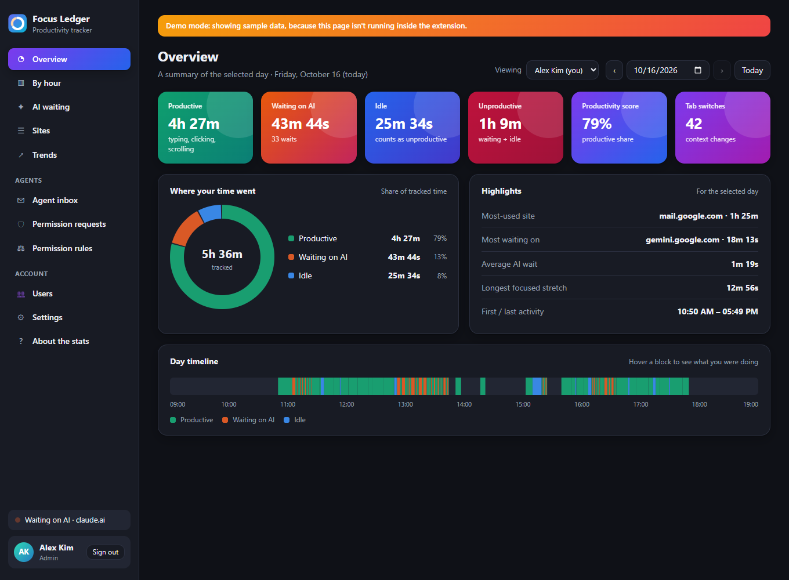
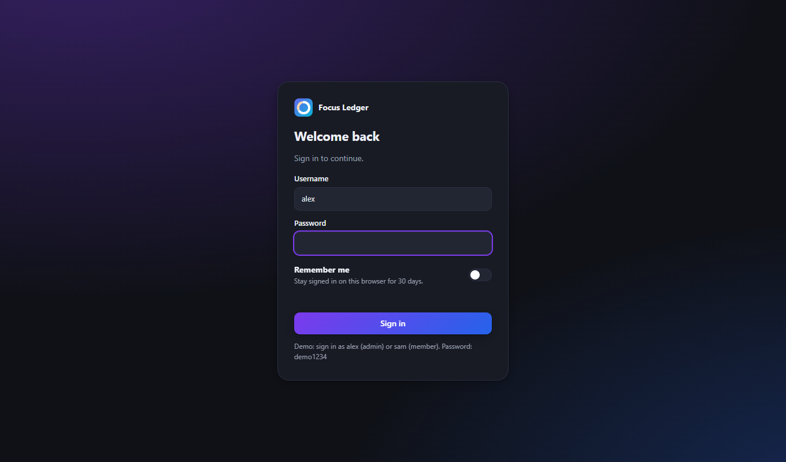
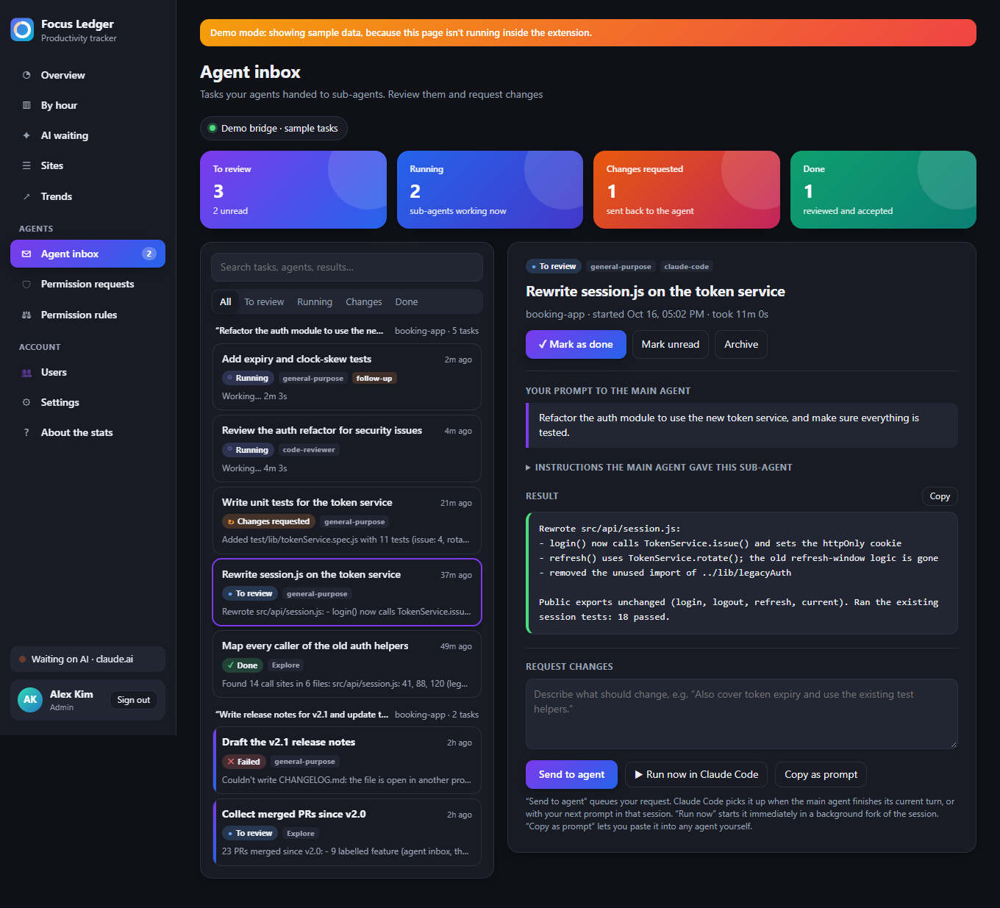
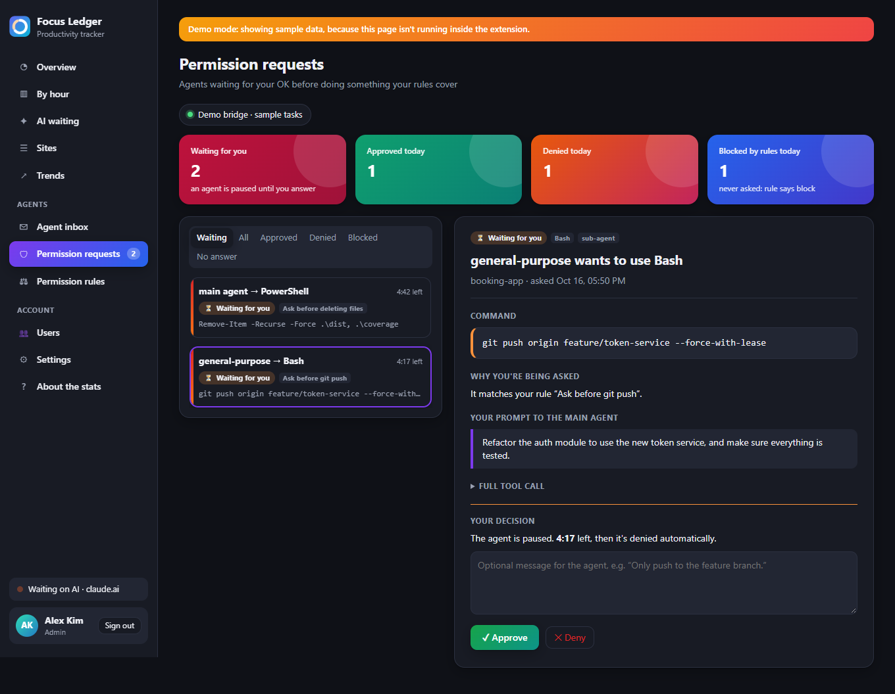

# Focus Ledger

A Google Chrome extension (Manifest V3) that tracks how your browser time splits between:

| State | Meaning |
|---|---|
| **Productive** | You typed, clicked, scrolled or moved the mouse within the last *N* seconds (default 10). |
| **Waiting on AI** | You're on an AI chat site, you've sent a prompt or a reply is streaming, and you aren't typing. Moving the mouse doesn't count as working here. |
| **Idle** | No input for *N* seconds on any other page. |

**Unproductive** = Waiting on AI + Idle. You can leave Idle out in Settings.

Only **the tab you're actually using** counts: the visible, focused tab in the focused Chrome window, while your computer is unlocked.



## Accounts and sign-in

- **First run:** the extension asks you to create the **admin** account. Anything tracked before that belongs to the admin.
- **Users** (admin only) is where the admin adds people and sets each person's role (Admin or Member). For members, the admin also switches individual permissions on or off:
  - see the Agent inbox
  - send change requests to agents
  - approve or deny permission requests
  - pause their own tracking

  The admin can also reset passwords, disable or delete accounts, and open anyone's stats with the *Viewing* menu. There must always be at least one active admin.
- **Admin-only controls:** permission rules, the agent bridge, tracking settings (idle cutoff, AI sites, retention) and the user list. Members see these settings read-only.
- **Personal settings:** each person has their own theme, pause switch and password (*Settings → My account*).
- **Signing in:** you sign in from the popup or the dashboard. The sign-in form is pre-filled with the **last user**. Tick **Remember me** to stay signed in for 30 days; otherwise you stay signed in until Chrome closes. *Sign out* in the sidebar or popup switches user. After 5 wrong passwords, sign-in pauses for 30 seconds.
- **What's recorded:** time is recorded only for whoever is signed in, and nothing is recorded while nobody is. The toolbar badge shows `?` when nobody is signed in.



> Accounts keep people's data and controls apart on a shared Chrome profile. Passwords are stored only as salted PBKDF2-SHA256 hashes. Someone with access to the profile's files or DevTools could still read raw storage, so this isn't protection against the computer's owner.

## Install in Google Chrome

1. Open `chrome://extensions`.
2. Turn on **Developer mode** (top right).
3. Click **Load unpacked** and pick this folder.
4. Pin the extension.

The badge shows today's unproductive minutes. Its color shows your current state: green = productive, orange = waiting on AI, blue = idle, gray "II" = paused.

The extension was tested in Google Chrome 154. It needs Chrome 116 or newer.

## The interface

**Popup** (click the toolbar icon) shows:
- today's unproductive time and productivity ring
- your live status
- three colored tiles: Productive / Waiting on AI / Idle
- a by-hour chart and your top sites
- quick toggles (pause, count idle) and theme swatches

**Dashboard** (from the popup's *Open full dashboard*, or the extension's *Options*):

| Section | What it shows |
|---|---|
| Overview | Six gradient KPI cards, a time-split donut, highlights, and a timeline of the day you can hover |
| By hour | Stacked hourly chart, your most and least productive hour, and a table view |
| AI waiting | Total, count, average and longest wait, a wait-length histogram, waiting time per AI site, and working vs. waiting on each AI site |
| Sites | Every site with Productive / Waiting / Idle / Total, its share of the day, and an AI/Other filter |
| Trends | Daily stacked totals and productivity score over 7, 14 or 30 days |
| Agent inbox | Sub-agent tasks from your agents: review them, mark them done, request changes (see below) |
| Permission requests | A separate inbox for agents waiting for your OK; approve or deny each request, with an optional message |
| Permission rules | *(admin)* What agents must ask for, what's always blocked and what's always allowed |
| Users | *(admin)* Accounts, roles and what each person may do |
| Settings | 7 theme presets (Auto, Daylight, Midnight, Ocean, Sunset, Forest, Candy), tracking rules, the list of AI domains, export and delete |
| About the stats | What every number means and how data is stored |

Use the day picker to look back at earlier days. Screenshots of every section are in [docs/screenshots](docs/screenshots).

## Agent inbox (sub-agent tasks)

When you give a prompt to a main agent that hands work to sub-agents, each sub-agent task shows up in the **Agent inbox**. Tasks are grouped under the prompt you gave the main agent. For each task you can:

- read the instructions the sub-agent got, and its result (or error)
- **Mark as done** once you've checked it, or mark it unread or archive it
- **Request changes**. Your request goes back to the agent:
  - **Send to agent**: Claude Code picks it up when the main agent finishes its turn (Stop hook), or with your next prompt in that session (UserPromptSubmit hook).
  - **Run now in Claude Code**: resumes the session right away as a background fork (`claude -p --resume <id> --fork-session`). This only appears when the `claude` CLI is on PATH. The result comes back to the inbox as a *follow-up* task.
  - **Copy as prompt**: paste the request into any agent yourself.

A Chrome notification tells you when a sub-agent finishes. The popup shows the latest tasks too.



## Permission rules and requests

The admin decides what agents must ask permission for (*Dashboard → Permission rules*). Before any tool call by the main agent or a sub-agent, the call is checked against the rules from top to bottom, and the first enabled match decides:

| Action | What happens |
|---|---|
| **Ask me first** | The agent pauses and a request appears in **Permission requests**, separate from the Agent inbox. Chrome shows a notification with **Approve / Deny** buttons, the badge shows `!1`, and the popup lets you answer inline. |
| **Always block** | The call is denied, and the agent is told not to retry. It's logged as "Blocked by rule". |
| **Always allow** | The call goes through without any prompt. |

A rule matches on **tools** (for example `Bash,PowerShell`, `Write,Edit`, `WebFetch`, `mcp__*` or `*`) and, optionally, on **text** in the call (contains or regex). The text is the shell command, file path, URL, search query or sub-agent prompt. A rule can apply to the main agent, sub-agents, or both. The *Try it* box shows which rule a call would hit. Default rules:
- Ask before deleting files
- Ask before `git push`
- Ask before installing packages
- Never read `.env` files
- Ask before sub-agents fetch web pages (off by default)

The agent waits up to the configured time (default 5 minutes). If nobody answers, the request is **denied** or **handed to the agent's own permission prompt**, whichever the admin chose. A message you add when approving or denying is passed to the agent. Every request records who answered and when.



Rules are enforced by the bridge through the Claude Code `PreToolUse` hook. While the bridge isn't running, rules aren't applied, and Claude Code falls back to its normal permission settings.

### How it connects

Chrome extensions can't see what your terminal or IDE agents are doing, so a small local **bridge** sits in between:

```
Claude Code ──hooks──▶ bridge (127.0.0.1:47321) ◀──polls── extension
                         ▲     └── change requests ──hooks──▶ Claude Code
                    any agent tool can POST tasks too
```

1. **Start the bridge** in this folder and keep it running. It needs Node 18 or newer, with no dependencies. It prints a **pairing token**.

   ```bash
   node bridge/server.mjs
   ```

2. **Pair:** paste the token into Dashboard → Settings → Agent bridge, then click *Test connection*.
3. **Connect Claude Code (once).** This adds one hook to `~/.claude/settings.json`, which every Claude Code session reads, including the desktop app's Code tab. It keeps your other settings and writes a backup first. Use `--print` to see the JSON without writing it, or `--uninstall` to remove it.

   ```bash
   node bridge/install-claude-hooks.mjs
   ```

The hook listens for `UserPromptSubmit`, `PreToolUse` on every tool (for permission rules, with a 15-minute hook timeout so it can wait for you), `PostToolUse` on the `Agent` (older: `Task`) tool, `SubagentStart`, `SubagentStop` and `Stop`. **If you installed the hooks before this version, run the installer again** so `PreToolUse` covers every tool. If the bridge isn't running, the hook exits silently and never slows down or blocks Claude Code.

**Other agent tools** (the Agent SDK, LangGraph, your own orchestrator, …) can report tasks with plain HTTP:

```bash
curl -X POST http://127.0.0.1:47321/api/events \
  -H "content-type: application/json" -H "x-focus-ledger-token: $(cat ~/.focus-ledger/token)" \
  -d '{"event":"task.started","sessionId":"run-1","taskId":"t1","agent":"researcher","title":"Find pricing pages","prompt":"..."}'
# later: {"event":"task.completed","sessionId":"run-1","taskId":"t1","result":"..."}
# change requests for a session: POST /api/feedback/claim {"sessionId":"run-1"}
```

Events: `session.prompt` (the user's prompt to the main agent), `task.started`, `task.completed`, `task.failed`.

To apply permission rules from your own tool, call `POST /api/permissions/check` with `{sessionId, toolName, toolInput, agentId?}`. If the answer is `pending`, long-poll `GET /api/permissions/<id>/wait` until `status` is `approved`, `denied` or `expired`.

### Bridge security and data

- The bridge listens on `127.0.0.1` only. Every request needs the pairing token. Browser requests are accepted only from `chrome-extension://` origins, so a website can't read your tasks or slip instructions to your agents.
- Rules are stored in `~/.focus-ledger/rules.json`. Permission requests and tasks are stored in `~/.focus-ledger/tasks.json`.
- Tasks are stored in `~/.focus-ledger/tasks.json` (the newest 1000), separately for each OS user. The extension keeps a copy in this Chrome profile only. Changing the bridge address or token clears that copy, so tasks from two bridges never get mixed.
- "Run now" options: set `FOCUS_LEDGER_CLAUDE_ARGS` (for example `--permission-mode acceptEdits`) to control what the resumed session may do without asking. By default your normal Claude Code permission settings apply.
- Settings: `FOCUS_LEDGER_PORT` (default 47321), `FOCUS_LEDGER_DIR` (default `~/.focus-ledger`), `FOCUS_LEDGER_CLAUDE_CMD` (default `claude`).

### Demo mode

If you open `popup.html` or `dashboard.html` outside the extension, `demo-data.js` fills them with two weeks of sample data and sample inbox tasks so you can look around. To try it, run a local server in this folder and open `http://127.0.0.1:8765/dashboard.html`:

```bash
python -m http.server 8765
```

Inside the extension, `demo-data.js` does nothing.

## How your data is kept separate

- Everything is stored in `chrome.storage.local`. That storage belongs to this Chrome profile on this computer, and it is never synced or uploaded.
- Each **user account** has its own history (`day:<userId>:YYYY-MM-DD`). Members see only their own stats; admins can view everyone's. Exports never include accounts, password hashes, sessions or the pairing token.
- Incognito windows are not tracked (`"incognito": "not_allowed"`).
- Each day is its own record. Time that crosses an hour or midnight is split, so it never lands in the wrong hour or day.
- Only site names (for example `claude.ai`) are stored. Page contents, what you type and full URLs are never recorded.

## Files

| File | Role |
|---|---|
| `manifest.json` | Extension manifest (MV3) |
| `content.js` | Runs in each page. Watches your input and the AI's "Stop" button, and reports a time slice every 5 s while the tab is focused. |
| `background.js` | Checks that the slice came from the active tab in the focused window. It then saves totals, per-site, per-hour, timeline, AI-wait episodes and tab switches. |
| `shared.js` | Settings defaults, themes and helpers |
| `auth.js` | Accounts, password hashing, sessions, sign-in screen |
| `agents.js`, `inbox.js`, `inbox.css` | Bridge client, Agent inbox view and styles for the inboxes, rules and accounts |
| `permissions.js` | Permission requests inbox and the rules editor |
| `users.js` | Users page and *My account* |
| `bridge/` | Local bridge server, Claude Code hook and hook installer (run with Node; not part of the extension) |
| `charts.js` | Small SVG chart helpers with hover tooltips. They have no dependencies, because extension pages can't load remote libraries. |
| `popup.*`, `dashboard.*`, `styles.css` | The interface |
| `demo-data.js` | Sample data, used only when the pages are opened outside the extension |

## Limitations

- If a site has no "Stop" button the extension can detect, "Waiting on AI" lasts from when you send a prompt until you type again, or until *max wait* runs out (180 s by default).
- Pages Chrome doesn't let extensions run on, such as `chrome://` pages and the Web Store, aren't tracked.
